# izlek

[](https://github.com/mucan54/izlek/actions/workflows/ci.yml)

**Self-hosted, lightweight product analytics.** Event collection, identity merging, trends, funnels, retention, SQL, client-side feature flags and wireframe session replay — with **object storage as the only durable dependency**. No database cluster, no message queue, no stream processor.

*izlek* is Turkish for "trace" or "theme". The UI ships in English and Turkish.

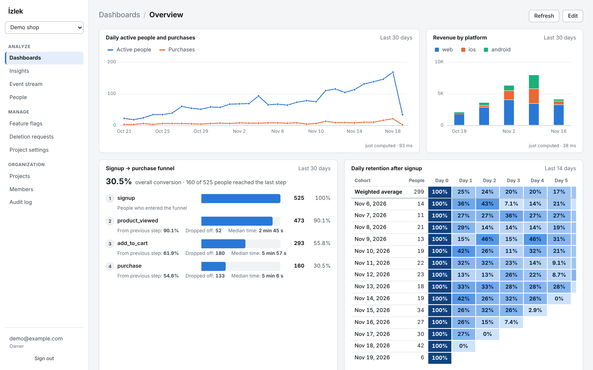

> **Status: v0.1, not production-ready.** Every component in the design is implemented and the whole pipeline runs end to end with the real binaries in CI (including against MinIO). It has **not** been run on a cloud provider's own S3, on multiple ingestion nodes, on real Android/iOS devices, or under sustained load. [`docs/status.md`](docs/status.md) lists exactly what was verified and what was not; read [Status and limitations](#status-and-limitations) before you depend on it.

---

## Contents

- [Why](#why)
- [What you get](#what-you-get)
- [Architecture](#architecture)
- [Quick start](#quick-start) — [Coolify](#coolify-recommended)
- [Sending events](#sending-events)
- [Identity](#identity)
- [Feature flags](#feature-flags)
- [Session replay](#session-replay)
- [Querying](#querying)
- [Administration](#administration)
- [AI assistants (MCP)](#ai-assistants-mcp)
- [Privacy and data deletion](#privacy-and-data-deletion)
- [Configuration](#configuration)
- [Operations](#operations)
- [Testing](#testing)
- [Measurements](#measurements)
- [Status and limitations](#status-and-limitations)
- [Repository layout](#repository-layout)
- [Documentation](#documentation)

---

## Why

Most analytics stacks need a columnar database cluster, a queue, a stream processor and a metadata database before the first event is stored. izlek takes the opposite position: for small and mid-sized products, a bucket and a handful of stateless processes are enough.

- **One durable dependency.** Everything that must survive lives in an S3-compatible bucket (or a directory on a single machine). The services are stateless apart from a short-lived local write-ahead log and a small SQLite file for the admin UI.
- **Services never talk to each other.** All coordination happens through the bucket, using nothing but *create-if-absent* (`PUT` with `If-None-Match: *`). Any process can be killed and restarted at any point.
- **Acknowledged means durable.** Ingestion answers `200` only after the batch has been `fsync`ed. Every later stage is idempotent, so an acknowledged event shows up in queries exactly once.
- **Small clients.** The web SDK core is 3.7 KB gzipped. Feature flags are evaluated on the device; replay records a wireframe, not pixels.
- **Easy to migrate to.** A PostHog-compatible ingestion endpoint accepts existing `posthog-js` and `posthog-node` (5.x) clients unchanged.

## What you get

### Trends

Counts, unique people, sums, averages, minima and maxima over time, with filters and breakdowns on any event or person property.

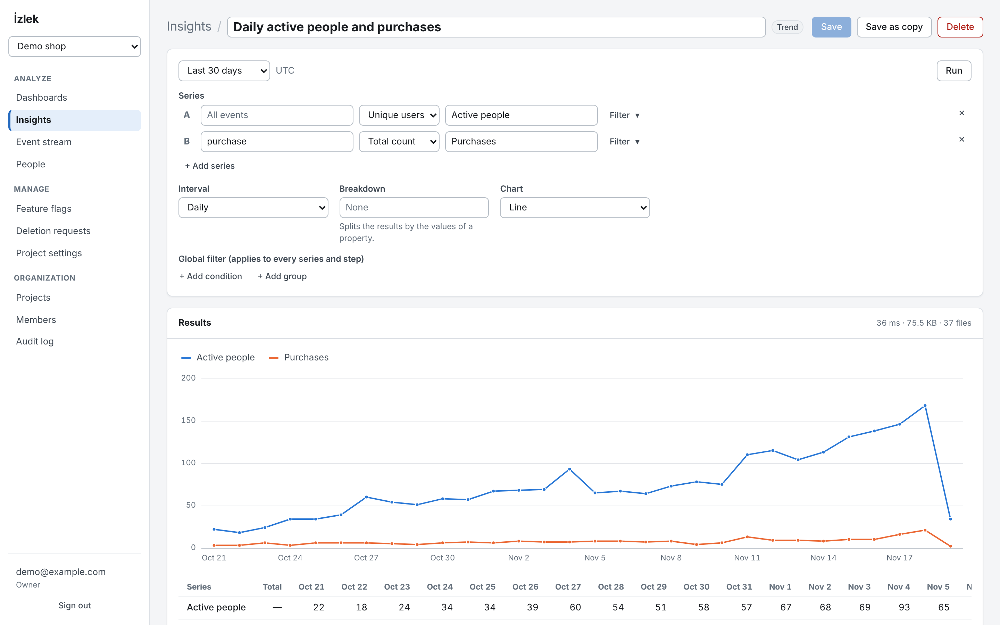

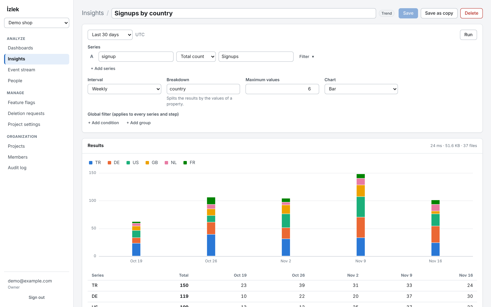

### Funnels

Ordered, strict or any-order funnels with a conversion window, per-step filters, breakdowns and median time between steps. A streaming operator walks events in `(person, time)` order instead of self-joining; on the benchmark below that was about 28× faster than the equivalent SQL.

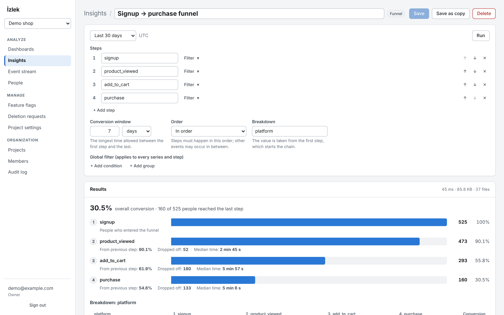

### Retention

Cohorts by day, week or month, with any start and return event.

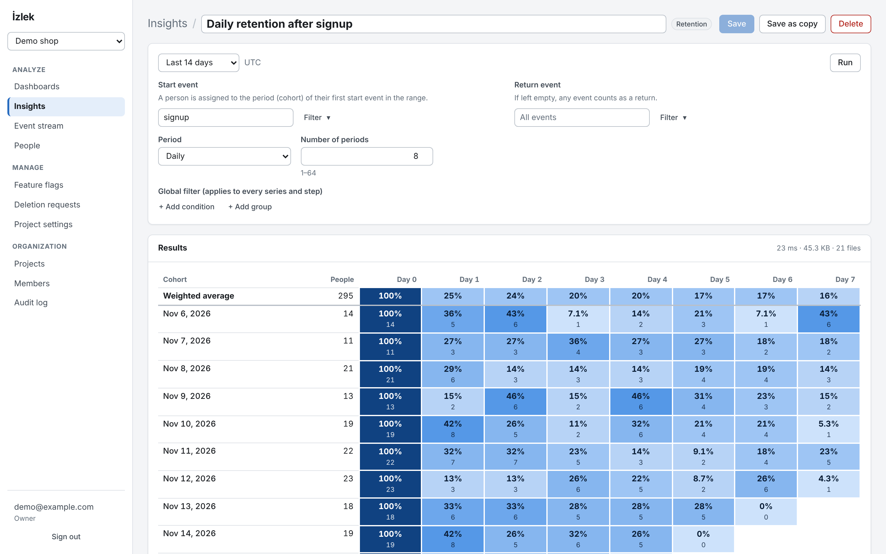

### Live events and people

A filterable event feed, and a page per person with their current properties, timeline and recorded sessions. Events sent before someone signed in are attributed to them afterwards (see [Identity](#identity)).

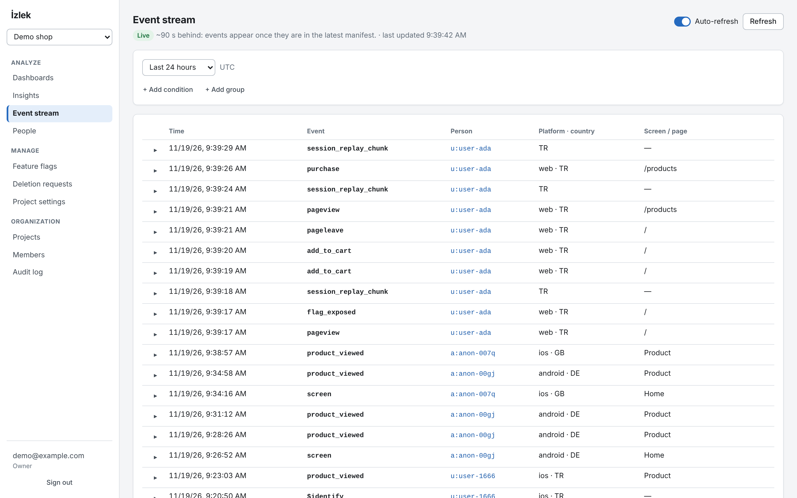

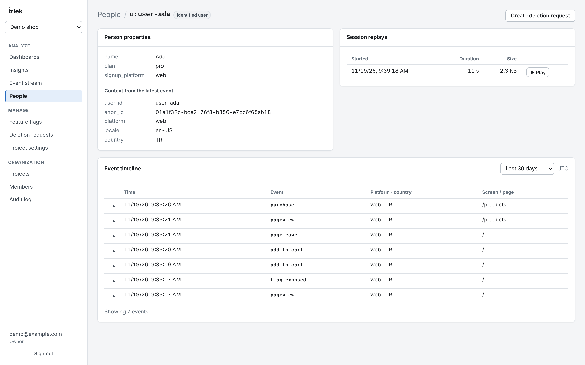

### Session replay

Replay records the **structure** of the page or screen — boxes, text, colours — at up to two frames per second, not a video and not the DOM. Input values are masked on the device before anything is sent; in the screenshot below the e-mail address and the card number typed during the session were never transmitted. A session costs a few kilobytes.

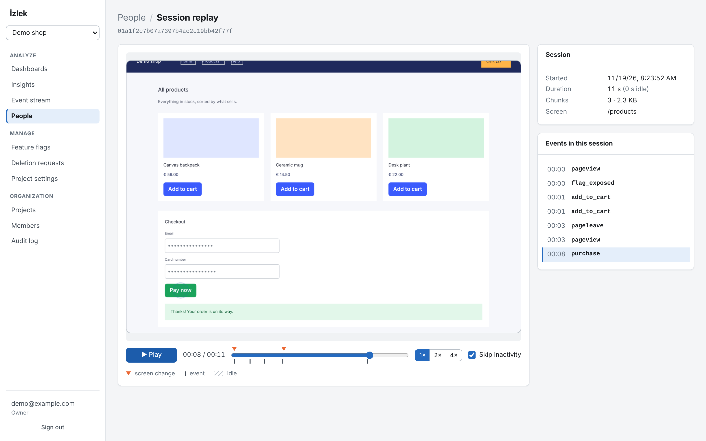

### Feature flags

Flags with ordered rules, percentage rollouts, weighted variants and property conditions (including semantic-version comparisons). The control plane publishes one small JSON file per write token; SDKs download it and **evaluate locally**, so a flag check costs no network round trip and keeps working offline. Go, TypeScript and Kotlin evaluators are tested against the same 117 vectors.

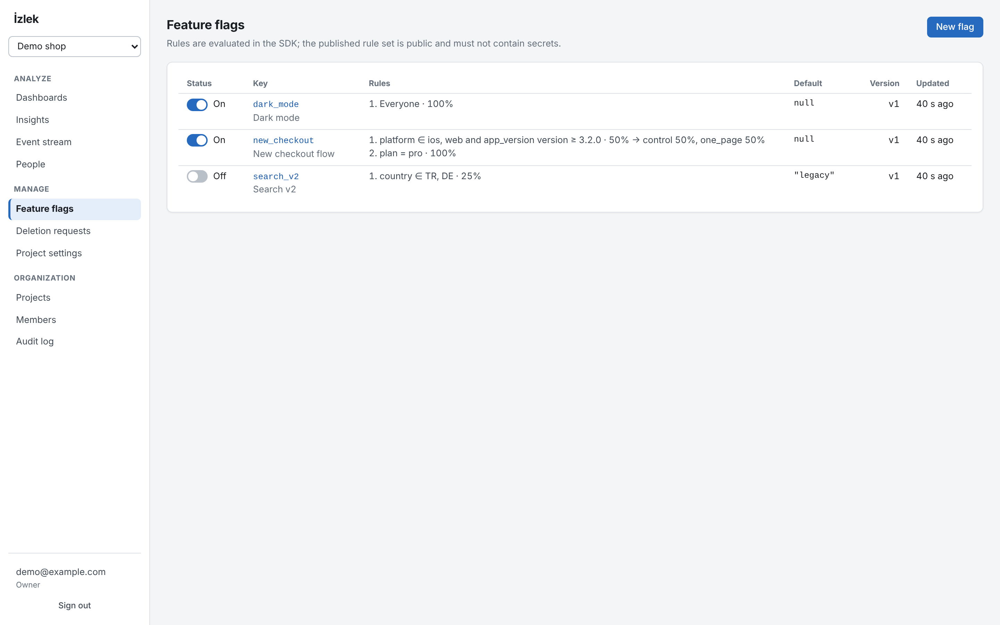

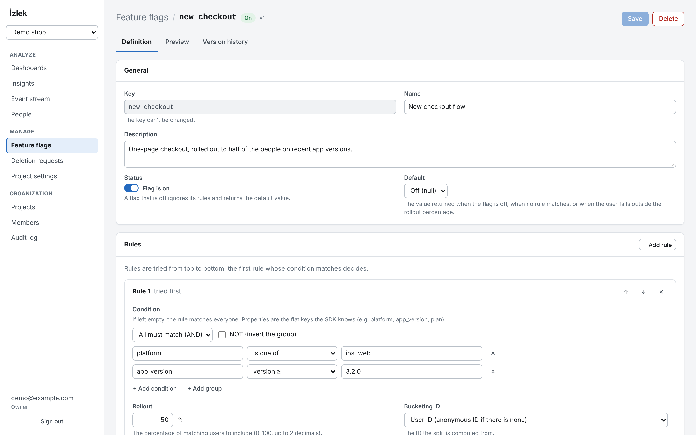

### And also

- **SQL** over your events and people (single `SELECT`, CTEs and subqueries allowed; DDL, DML and file/catalog access rejected at the plan level).
- **Dashboards** of saved insights.
- **Deletion requests** for GDPR/KVKK: a person disappears from query results within a minute and is physically removed by compaction.
- **Organisations, roles, write tokens, secret keys, TOTP, audit log.**

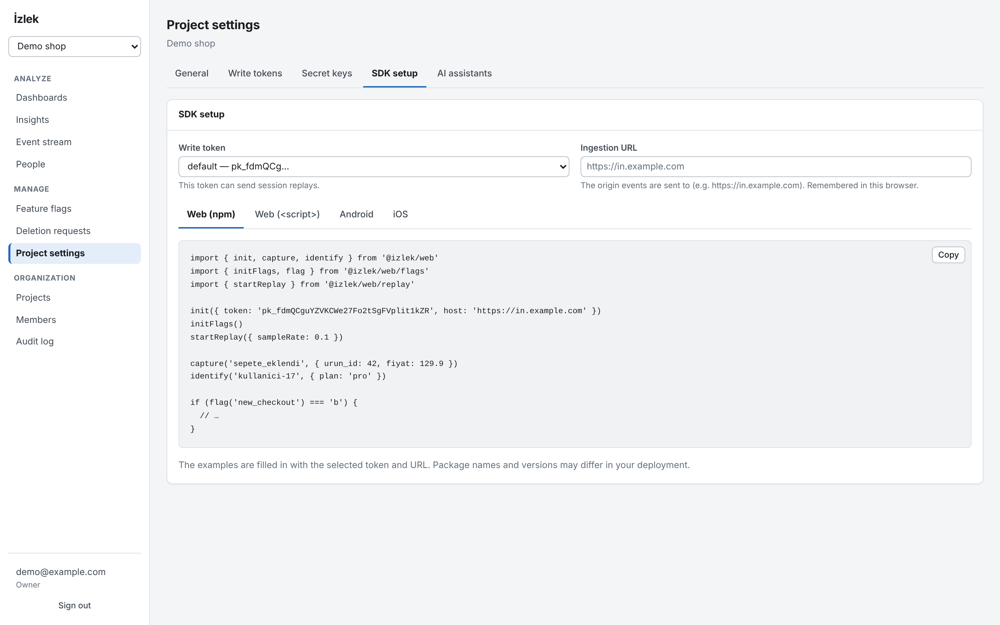

---

## Architecture

```
 SDKs (Kotlin Multiplatform · Web · PostHog-compatible clients)
        │  LA1 binary batches / PostHog JSON
        ▼
 ┌─────────────┐  fsync   ┌───────────┐  zstd    ┌──────────────────────────────────────┐
 │  la-ingest  │────────▶ │ local WAL │────────▶ │            object storage            │
 │    (Go)     │          └───────────┘          │                                      │
 └─────────────┘                                 │  wal/       acknowledged batches     │
                                                 │  data/      sorted Parquet, per day  │
 ┌─────────────────────────────┐                 │  identity/  anonymous → user links   │
 │ la-shipper ship   (Rust)    │◀───────────────▶│  persons/   person properties        │
 │   WAL → Parquet L0          │                 │  replay/    session replay chunks    │
 │ la-shipper compact          │                 │  flags/     published rule sets      │
 │   L0 → L1 → L2, GC, deletes │                 │  control/   tokens, keys, projects   │
 └─────────────────────────────┘                 │  tombstones/ deletion requests       │
                                                 └──────────────────────────────────────┘
 ┌─────────────────────────────┐                        ▲                    ▲
 │ la-query  (Rust, DataFusion)│────────────────────────┘                    │
 │ trends · funnel · retention │                                             │
 │ events · SQL · replay       │◀──── query proxy ────┐                      │
 └─────────────────────────────┘                      │                      │
                                              ┌───────────────┐  snapshots   │
                                              │  la-control   │──────────────┘
                                              │  (Go, SQLite) │
                                              │  API + UI     │
                                              └───────────────┘
```

| Process | Language | Role |
|---|---|---|
| `la-ingest` | Go | Authenticates the write token, validates the frame, appends to a local WAL, group-`fsync`s, answers `200`, then uploads sealed segments. Also the PostHog adapter, replay upload and `/flags/<token>.json`. |
| `la-shipper ship` | Rust | Turns WAL segments into sorted Parquet files (level 0), resolves identity, maintains person properties, promotes frequent properties to typed columns. |
| `la-shipper compact` | Rust | Merges L0 → L1 → L2, applies retention and deletion requests, garbage-collects unreferenced files and old WAL. |
| `la-query` | Rust (DataFusion) | Read-only query service over the manifests and Parquet files. |
| `la-control` | Go + SQLite | Users, projects, tokens, flags, saved insights; publishes snapshots to the bucket; proxies queries for the UI; serves the SPA. |
| `la-canary` | Go | Optional synthetic probe: sends known events and checks that each is visible exactly once. |

### How data flows

1. **Ingest.** An SDK posts a batch. The hot path only checks the frame, deduplicates on `(project, batch_id)` and appends to the WAL; it does not parse event content. The response is written after `fsync`.
2. **Upload.** Segments rotate every 10 seconds (or 64 MB), are compressed with zstd and uploaded to `wal/dt=…/hh=…/`. If the bucket is unreachable, ingestion keeps accepting and buffers on local disk.
3. **Ship.** The shipper writes a numbered **plan** naming the segments it will process (create-if-absent), then executes it: decode → identity links → person properties → Parquet files with names derived from the plan number → day manifests → `_done` markers. Re-running a plan, even concurrently, produces the same objects.
4. **Compact.** Small files are merged into one file per day, sorted by `(person_key, ts, uuid)`. Deletion requests and retention are applied here.
5. **Query.** Each query takes a snapshot of the day manifests, prunes files and row groups, rewrites rows of people identified after a file was written, removes duplicates and streams the result through the operator.

### Guarantees and how they are met

| Guarantee | Mechanism |
|---|---|
| An acknowledged event is not lost | `200` only after `fsync`; segments are deleted locally only after a successful upload; the WAL is kept in the bucket for 30 days, so `data/` can be rebuilt from it. |
| An event is counted once | Batch-level dedupe at ingestion; deterministic plan output in the shipper; per-person `uuid` dedupe in both compaction and queries. |
| Projects are isolated | The project id comes only from the token or key, never from the request body; every object key carries the project prefix; isolation tests run in CI. |
| No lost updates without a coordinator | Versioned manifests committed with create-if-absent and retried on conflict; leases are a chain of create-if-absent objects. Verified with concurrent writers against MinIO in CI. |

The normative contracts — wire format, WAL, manifests, Parquet schema, flags, replay, query API, control API — live in [`spec/`](spec/), together with test vectors produced by an independent Python reference implementation.

---

## Quick start

### Coolify (recommended)

izlek is designed to be self-hosted on [Coolify](https://coolify.io) as a single resource:

1. **+ New → Public Repository** → `https://github.com/mucan54/izlek`, branch `main`.
2. **Build Pack:** Docker Compose · **Base Directory:** `/` · **Docker Compose Location:** `/docker-compose.coolify.yml`.
3. **Environment Variables** (all *Runtime*):

   ```
   ADMIN_EMAIL=you@example.com
   LA_PUBLIC_URL=https://analytics.example.com
   LA_PUBLIC_INGEST_URL=https://in.analytics.example.com
   ```

4. **Domains:** `control` → `https://analytics.example.com` (port 8090), `ingest` → `https://in.analytics.example.com` (port 8080). No domain on `init`, `bootstrap` or the other services.
5. **Deploy.** The first build compiles the Rust services and takes about 30 minutes; set `CARGO_BUILD_JOBS=1` if the server runs out of memory.
6. Sign in at `https://analytics.example.com` with `ADMIN_EMAIL` and the generated `SERVICE_PASSWORD_ADMIN` (shown under Environment Variables), then change the password under **Account**.

The full guide — DNS, every variable, S3 storage, backups, updates, connecting Claude/ChatGPT and a troubleshooting table of real deployment errors — is in **[`deploy/coolify/README.md`](deploy/coolify/README.md)**.


### Look around with demo data

Requires Go 1.24+, Rust (the version is pinned in `engine/rust-toolchain.toml`) and Node 22.

```sh
(cd engine  && cargo build -p la-shipper -p la-query)
(cd sdk-web && npm ci && npm run build)
(cd ui      && npm ci && npm run build)

node e2e/demo.mjs --serve
```

This starts every service on one machine with a temporary file store, sends a month of synthetic shop traffic, records one browser session with the web SDK, creates flags, insights and a dashboard, and prints the URL and credentials. The screenshots in this README were taken from exactly this setup (`node e2e/demo.mjs --shots docs/images`). `Ctrl-C` stops everything and deletes the data.

### Run it for real on one machine

```sh
deploy/local/run.sh
```

Builds everything, creates the first user and project (credentials, the write token and the secret key are written to `.local/bootstrap.txt`) and starts five processes:

| Service | Address |
|---|---|
| Ingestion (the SDK `host`) | `http://127.0.0.1:8080` |
| Query API | `http://127.0.0.1:8081` |
| Control plane and UI | `http://127.0.0.1:8090` |
| Shipper, compactor | metrics on `:9102`, `:9103` |

Data lives under `.local/` (override with `LA_HOME`). With default settings an event is visible in queries about 15–30 seconds after it was sent.

### Docker Compose

```sh
cd deploy/compose
cp .env.example .env        # set LA_QUERY_INTERNAL_SECRET (openssl rand -hex 32)
docker compose up -d --build
docker compose run --rm control bootstrap --email you@example.com --password '…' --org Acme --project Shop
```

Only ingestion (`8080`) and the control plane (`8090`) are published; every container has a health check (the images are shell-less, so they carry a small probe binary). Put a TLS-terminating proxy in front and set `LA_TRUSTED_PROXIES` and `LA_COOKIE_SECURE` accordingly. `deploy/compose/smoke.sh` builds the images, boots the stack and runs an end-to-end check; CI runs it on every push.

### Several machines

Give every process the same `LA_STORE_URL=s3://bucket[/prefix]` (plus `LA_S3_ENDPOINT`, `LA_S3_REGION`, `LA_S3_ACCESS_KEY`, `LA_S3_SECRET_KEY`). Run as many ingestion nodes as you need behind a load balancer; each needs a unique `LA_NODE_ID` and a local disk for its WAL. Shipper and compactor take a lease per shard, so running two of each gives you a standby. Query nodes are stateless.

The store must implement conditional writes (`If-None-Match: *` on `PUT`). Check your provider first:

```sh
export LA_TEST_S3_ENDPOINT=https://… LA_TEST_S3_BUCKET=… LA_TEST_S3_REGION=…
export LA_TEST_S3_ACCESS_KEY=… LA_TEST_S3_SECRET_KEY=…
(cd engine && cargo test -p la-core --test s3_real)        # needs the bucket to exist
go test -count=1 -run 'TestContract|TestPutIfAbsentRace' ./golib/objstore/   # creates its own bucket
```

---

## Sending events

### Web

```html
<script src="izlek.min.js"></script>
<script>
  izlek.init({ token: 'pk_…', host: 'https://in.example.com' })

  izlek.capture('added_to_cart', { sku: 'bag-01', price: 59 })
  izlek.identify('user-1017', { plan: 'pro' })
</script>
```

or as a module:

```ts
import { init, capture, identify } from '@izlek/web'

init({ token: 'pk_…', host: 'https://in.example.com' })
capture('added_to_cart', { sku: 'bag-01', price: 59 })
```

The core (3 751 bytes gzipped, enforced by a size budget in the test suite) does capture, identity, a persistent retry queue, sessions and automatic `pageview`/`pageleave` including single-page navigation. Clicks are tracked only on elements you mark:

```html
<button data-track="checkout_started" data-track-plan="pro">Checkout</button>
```

Batches are persisted to `localStorage` until acknowledged and re-sent with the same batch id, so the server can drop repeats. The SDK never throws into the page, does nothing during server-side rendering, and does not start for known bot user agents. Details: [`sdk-web/README.md`](sdk-web/README.md).

The package is not published to npm yet; build it with `npm run build` in `sdk-web/` and serve `dist/izlek.min.js`, or import from the directory.

### Android, iOS and JVM (Kotlin Multiplatform)

```kotlin
Analytics.setup(Config(token = "pk_…", host = "https://in.example.com"), PlatformContext(this))

Analytics.capture("purchase", mapOf("amount" to 12.5, "items" to listOf(1, 2)))
Analytics.screen("Checkout")
Analytics.identify("user-1017", mapOf("plan" to "pro"))
```

Modules: `analytics-core`, `analytics-flags`, `analytics-replay`, optional `analytics-replay-compose`, and a test kit. The queue is an append-only file with checksummed records, so a process killed mid-write loses at most the record being written.

> Only the **JVM target** has been compiled and tested here (108 tests, plus a sample app exercised by the end-to-end suite). The Android and iOS source sets exist but were never built on a device, and nothing is published to Maven or packaged as an XCFramework. See [`sdk-kmp/README.md`](sdk-kmp/README.md).

### PostHog-compatible clients

Point an existing PostHog SDK at the ingestion host and use an izlek write token as the API key:

```js
posthog.init('pk_…', { api_host: 'https://in.example.com' })
```

`/batch`, `/capture`, `/e`, `/i/v0/e` and the flag endpoints the SDKs probe are implemented. `$identify`, `$set`, `$set_once` and `$unset` map to izlek identity and person properties. Verified in CI against `posthog-js` 1.451.1 and `posthog-node` 5.74.0. **`posthog-node` 6 and later use a different capture endpoint and are not supported.**

### Plain HTTP

```sh
curl -H 'Content-Type: application/json' https://in.example.com/batch/ -d '{
  "api_key": "pk_…",
  "batch": [
    { "event": "signup",   "distinct_id": "user-1017", "properties": { "method": "email" } },
    { "event": "purchase", "distinct_id": "user-1017", "properties": { "amount": 59.0 },
      "timestamp": "2026-11-18T09:30:00Z" }
  ]
}'
```

The native endpoint is `POST /v1/e` with the compact binary `LA1` format described in [`spec/wire.md`](spec/wire.md).

| Status | Meaning for the client |
|---|---|
| `200` | Stored durably. Drop the batch. |
| `400` | Malformed. Drop it; retrying will not help. |
| `401` / `403` | Unknown or disabled token, or origin not allowed. Stop sending for a while. |
| `413` | Too large. Split the batch. |
| `429` / `503` | Slow down; honour `Retry-After`. |

---

## Identity

Every event carries an anonymous id generated on the device and, once known, a user id.

- `person_key` is `u:<user_id>` when a user id is present, otherwise `a:<anon_id>`.
- `identify(userId)` links the current anonymous id to the user. **The first link wins**: an anonymous id belongs to one user for good.
- Events sent **before** `identify` are attributed to the user as well. This is resolved in three places — when a file is written, at query time for files older than the link, and permanently at compaction — so a funnel that starts anonymously and ends signed in counts one person.
- Person properties are last-write-wins per key; `$set_once` only fills a key that is empty.

---

## Feature flags

Define flags in the UI or through the API. A rule set looks like this:

```json
{
  "key": "new_checkout",
  "enabled": true,
  "rules": [
    {
      "when": { "and": [
        { "prop": "platform",    "op": "in",         "value": ["ios", "web"] },
        { "prop": "app_version", "op": "semver_gte", "value": "3.2.0" }
      ] },
      "rollout": 5000,
      "variants": [ { "key": "control", "w": 5000 }, { "key": "one_page", "w": 5000 } ]
    },
    { "when": { "prop": "plan", "op": "eq", "value": "pro" }, "rollout": 10000 }
  ],
  "default": null
}
```

Rules are tried top to bottom and the first matching rule decides. Rollout and variant buckets are `murmur3_32(salt + key + id) mod 10000`, so a person stays in the same bucket across devices and sessions. Operators: `eq`, `ne`, `in`, `not_in`, `gt`, `gte`, `lt`, `lte`, `contains`, `regex`, `is_set`, `semver_gte`, `semver_lt`.

```ts
import { initFlags, flag } from '@izlek/web/flags'

await initFlags()
if (flag('new_checkout') === 'one_page') { /* … */ }
flag('beta_banner', false)          // default when the flag is off or unknown
```

```kotlin
Flags.setup()
if (Flags.isEnabled("new_checkout")) { /* … */ }
```

The first evaluation in a session records a `flag_exposed` event, which you can use as a funnel step or breakdown. Rule sets are served by the ingestion host at `/flags/<token>.json` with `ETag` and `Cache-Control`, so a CDN can sit in front. A change reaches clients after the publish delay (≤ 2 s), the ingestion copy (≤ 30 s), any CDN cache (60 s) and the SDK refresh interval (5 minutes while in the foreground). Full semantics: [`spec/flags.md`](spec/flags.md).

---

## Session replay

```ts
import { startReplay } from '@izlek/web/replay'

startReplay({ sampleRate: 0.1 })     // record 10 % of sessions
```

```kotlin
Replay.setup(ReplayConfig(sampleRate = 0.1), AndroidViewTreeSource(this))
```

What is recorded is a tree of rectangles with a type, a colour and optionally text, plus scroll and screen changes. Chunks close every 5 seconds or 64 KB, start with a full snapshot (so each can be played on its own) and are uploaded compressed.

Masking happens **at capture time**; masked content never leaves the device:

| Element | Default |
|---|---|
| `input`, `textarea`, `select`, `contenteditable` | Replaced by `•` of the same length |
| `type=password` | Always masked, cannot be unmasked |
| Images, video, canvas, SVG | A placeholder rectangle; no `src`, no `alt` |
| Other text | Recorded; `maskAllText: true` masks everything |
| `data-la-mask` / `data-la-unmask` | Mask or unmask a subtree |

Attribute values, HTML and keystrokes are never recorded. A write token must have replay enabled for uploads to be accepted. Format: [`spec/replay.md`](spec/replay.md).

---

## Querying

The UI is one client of the query API; you can use it directly with a secret key that has the `query` scope.

```sh
curl https://query.internal:8081/q/trends \
  -H 'Authorization: Bearer sk_…' -H 'Content-Type: application/json' -d '{
  "from": "2026-11-01", "to": "2026-11-18", "interval": "day",
  "series": [
    { "event": "purchase", "agg": "count" },
    { "event": null,       "agg": "unique", "label": "Active people" },
    { "event": "purchase", "agg": "sum", "prop": "props.amount" }
  ],
  "filter": { "prop": "country", "op": "in", "value": ["TR", "DE"] },
  "breakdown": "platform"
}'
```

```jsonc
// POST /q/funnel
{ "from": "2026-11-01", "to": "2026-11-18",
  "steps": [ { "event": "signup" },
             { "event": "purchase", "filter": { "prop": "props.amount", "op": "gt", "value": 20 } } ],
  "window_seconds": 604800, "order": "ordered", "breakdown": "platform" }

// POST /q/retention
{ "from": "2026-10-01", "to": "2026-11-18", "period": "week", "periods": 8,
  "start": { "event": "signup" }, "return": { "event": null } }

// POST /q/events
{ "from": "2026-11-18", "to": "2026-11-18", "limit": 100, "order": "desc",
  "filter": { "prop": "event", "op": "eq", "value": "purchase" } }

// POST /q/sql
{ "from": "2026-11-01", "to": "2026-11-18",
  "sql": "SELECT event, count(*) AS n, count(DISTINCT person_key) AS people FROM events GROUP BY 1 ORDER BY 2 DESC LIMIT 10" }
```

| Endpoint | Purpose |
|---|---|
| `POST /q/trends` | Time series with `count`, `unique`, `sum`, `avg`, `min`, `max`; breakdown with top-N and `$other` |
| `POST /q/funnel` | `ordered`, `strict` or `any` order; window; per-step filters; breakdown; median time per step |
| `POST /q/retention` | Cohorts by `day`, `week`, `month` |
| `POST /q/events` | Raw events with cursor paging |
| `POST /q/sql` | One `SELECT` over `events` and `persons`; helpers `prop(props,'k')`, `prop_num`, `prop_bool`, `hex(uuid)` |
| `POST /q/schema` | Known event names and properties (for autocompletion) |
| `GET /q/replay?key=…` | A replay chunk, restricted to the caller's project prefix |

Filters are a small expression tree (`and`, `or`, `not`, `{prop, op, value}`) over fixed columns (`event`, `platform`, `country`, `app_version`, `url_path`, …), `props.<key>` and `person.<key>`. All buckets are UTC. Every response carries a `meta` object with elapsed time, bytes scanned, file count and whether it came from the result cache.

Per-project limits protect the service: concurrent queries with a bounded queue (`429`), a time limit (`408`), a scanned-bytes limit (`422`) and a memory budget per query (`422`). Exact semantics, including the precise definition of each funnel mode: [`spec/query.md`](spec/query.md).

---

## Administration

The control plane exposes everything the UI does under `/api` ([`spec/control.md`](spec/control.md)).

- **Organisations and roles**: `owner` > `admin` > `member` > `viewer`.
- **Write tokens** (`pk_…`) identify a project to ingestion. They are public by nature; each can be restricted to browser origins, rate-limited, and allowed or denied replay. Disabling one takes effect on ingestion within the token poll interval (30 s).
- **Secret keys** (`sk_…`) authorise the query API (`query` scope) and the admin API for their own project (`admin` scope). Only the SHA-256 of a key is stored or published; the key is shown once.
- **Sessions** use an `HttpOnly`, `SameSite=Lax` cookie plus a CSRF header; passwords are hashed with argon2id; TOTP is available; login attempts are rate-limited. OIDC is not implemented.
- **Audit log** of every administrative action.

```sh
la-control bootstrap --email you@example.com --password '…' --org Acme --project Shop
la-control backup /backups/control-$(date +%F).db     # consistent copy while running
```

The control plane is not on the data path. While it is down, ingestion, flag evaluation and queries with secret keys keep working.

---

## AI assistants (MCP)

The control plane is also a remote [Model Context Protocol](https://modelcontextprotocol.io) server, so you can set up and operate izlek from an assistant such as **Claude** or **ChatGPT** instead of the web UI: "create a project for my shop and give me the snippet for a web page", "did the events arrive?", "roll out `new_checkout` to 20 % of iOS users", "what was last week's signup-to-purchase conversion by platform?".

```sh
# Claude Code, with a personal access token: every organisation and project you belong to, with your role
claude mcp add --transport http izlek https://analytics.example.com/mcp \
  --header "Authorization: Bearer pat_…"

# Claude Code, with a secret key (admin scope) of one project
claude mcp add --transport http izlek https://analytics.example.com/mcp \
  --header "Authorization: Bearer sk_…"

# Claude Code, signing in as yourself in the browser (OAuth)
claude mcp add --transport http izlek https://analytics.example.com/mcp
```

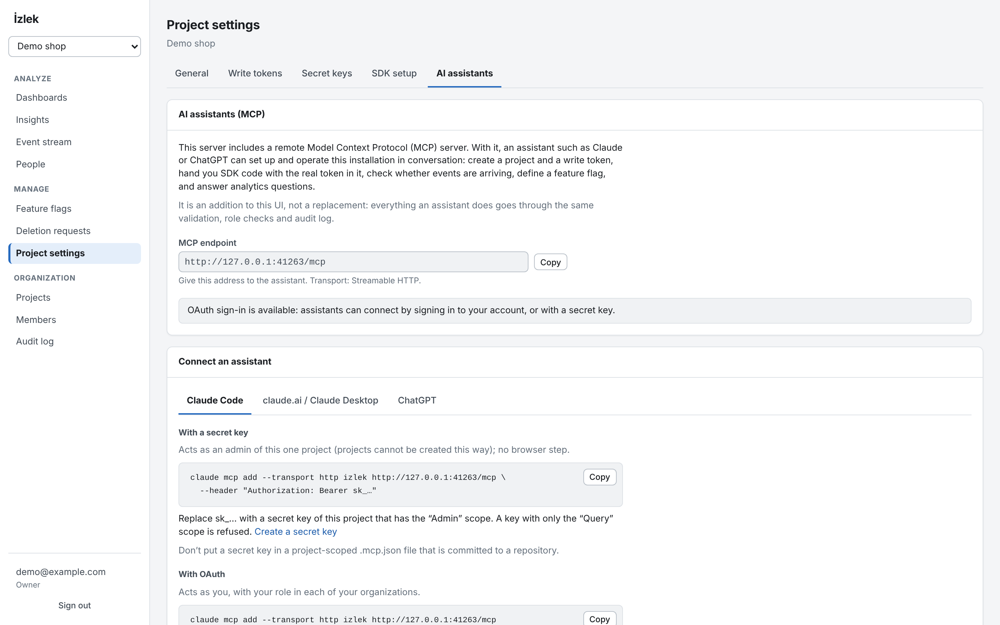

In **claude.ai / Claude Desktop** and **ChatGPT**, add a custom connector with the URL `https://analytics.example.com/mcp` and choose OAuth; you sign in to izlek and approve the request on a consent page (English or Turkish). Step-by-step instructions for each client: [`docs/mcp.md`](docs/mcp.md).

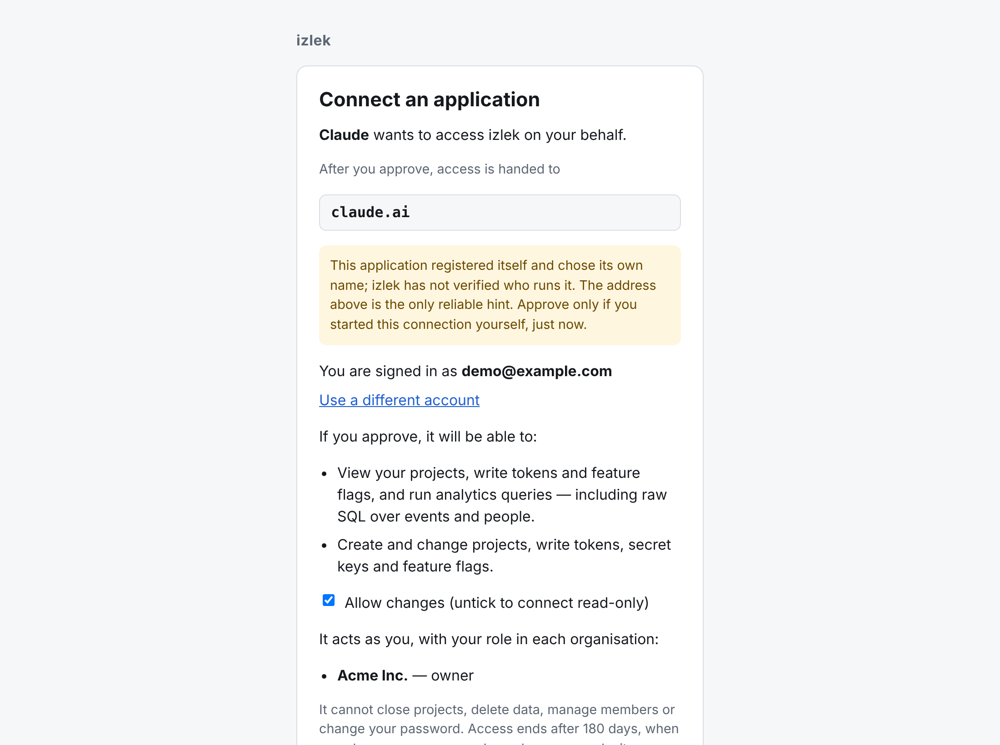

| Group | Tools |
|---|---|
| Setup | `list_projects`, `create_project`, `get_project`, `update_project_settings`, `list_write_tokens`, `create_write_token`, `update_write_token`, `list_secret_keys`, `create_secret_key`, `get_sdk_setup`, `verify_installation` |
| Feature flags | `list_flags`, `get_flag`, `create_flag`, `update_flag`, `evaluate_flag` |
| Analytics | `query_trends`, `query_funnel`, `query_retention`, `query_events`, `run_sql`, `get_schema` |

How it is built:

- **Three ways to authenticate.** A **personal access token** (`pat_…`, created under *Account → Access tokens*): account-wide, acts as you in every organisation and project with your current role, read-only or read-and-change, with an expiry; it also works on the HTTP API, except for account, member and destructive operations. A **project secret key** with the `admin` scope (one project only). Or OAuth 2.1 access tokens issued by the control plane itself, which act as the user who approved them with that user's roles. The built-in authorization server implements PKCE (S256), protected-resource and server metadata, Client ID Metadata Documents and dynamic client registration, the `resource` parameter with audience checks, rotating refresh tokens and revocation. Scopes are `izlek:read` and `izlek:admin`.
- **Same rules as the web UI.** Tools run the existing API handlers in-process, so validation, role checks and the audit log are shared; mutating calls are recorded with the assistant that made them.
- **Deliberately not exposed:** closing projects, deleting tokens, keys or flags, member management and deletion requests.
- **Protocol revisions.** One stateless endpoint (`POST /mcp`, JSON responses) serves both the handshake-based revisions (2025-03-26 to 2025-11-25) and the handshake-free 2026-07-28 revision.
- OAuth needs `LA_PUBLIC_URL` (the control plane's public `https://` origin); without it `/mcp` accepts secret keys only. *Project settings → AI assistants* shows the endpoint and the steps for each client; *Account → Connected apps* lists what you have authorised and revokes it. Changing your password revokes them all.

CI runs conformance tests with the official MCP client libraries (both protocol styles, the complete OAuth flow, and the consent page in Chromium), and the end-to-end suite drives the tools against the real query service. **It has not been tried against the hosted claude.ai or ChatGPT services**; their requirements were taken from their documentation.

Two things to keep in mind: `create_secret_key` puts a secret into the assistant's conversation, and query results contain text that came from your users' devices — an assistant that reads event data and can also change things should be given read-only access unless you need more.

## Privacy and data deletion

- **Deletion requests** (UI or `POST /api/projects/{id}/deletions`) write a tombstone. The query service hides the person — including their earlier anonymous history — within a minute; the compactor rewrites the affected days, deletes their replay chunks, person properties and identity links, and the request is marked done. Copies in the WAL expire with WAL retention (30 days by default), which is therefore the upper bound for complete erasure.
- **Retention** is per project, in days, for events and separately for replay.
- **Blocked properties** (`drop_keys`) are removed at write time and never reach Parquet.
- **Closing a project** stops ingestion for it and deletes everything it stored on the next compactor cycle.
- **IP addresses** are used only to derive a country (when a GeoIP database is configured) and for rate limiting; they are not stored. Request logs never contain payload content or tokens.
- The web SDK lists the fields it sends by itself and which of them are personal data in [`sdk-web/README.md`](sdk-web/README.md).

---

## Configuration

Everything is configured through environment variables. The most important ones:

| Variable | Used by | Default | Meaning |
|---|---|---|---|
| `LA_STORE_URL` | all | — | `s3://bucket[/prefix]` or `file:///absolute/dir` |
| `LA_S3_ENDPOINT`, `LA_S3_REGION`, `LA_S3_ACCESS_KEY`, `LA_S3_SECRET_KEY` | all | AWS, `us-east-1` | S3-compatible endpoint (path-style) and credentials |
| `LA_LISTEN` | ingest | `:8080` | Public listener |
| `LA_NODE_ID` | ingest | `ing-01` | Unique per node; part of segment names |
| `LA_WAL_DIR` | ingest | `/var/lib/la/wal` | Local write-ahead log |
| `LA_WAL_SEGMENT_SECONDS` | ingest | `10` | Segment rotation; the main lever on freshness |
| `LA_WAL_MAX_LOCAL_BYTES` | ingest | 70 % of the disk | Back-pressure threshold when uploads fail |
| `LA_TRUSTED_PROXIES` | ingest | `0` | Number of proxies in front (for client IP and rate limits) |
| `LA_RATE_IP`, `LA_RATE_TOKEN` | ingest | `50`, `2000` | Requests per second per IP and per token |
| `LA_GEO_DB` | ingest | — | Country MMDB file; without it country is unknown |
| `LA_COMPAT_POSTHOG` | ingest | `true` | PostHog-compatible endpoints |
| `LA_SHIPPER_BATCH_MB` | shipper | `64` | Uncompressed bytes per plan (memory ≈ 14× for small events) |
| `LA_COMPACTOR_INTERVAL_SECS` | compactor | `60` | Cycle interval |
| `LA_WAL_RETENTION_DAYS` | compactor | `30` | How long the WAL is kept (rebuild horizon, erasure bound) |
| `LA_QUERY_LISTEN` | query | `0.0.0.0:8081` | Listener |
| `LA_QUERY_INTERNAL_SECRET` | query, control | — | Shared secret for the UI's query proxy |
| `LA_QUERY_CACHE_DIR`, `LA_QUERY_CACHE_BYTES` | query | off, 20 GiB | Local disk cache of Parquet files |
| `LA_QUERY_MEMORY_BYTES`, `LA_QUERY_TIMEOUT_MS` | query | 2 GiB, 60 s | Per-query limits |
| `LA_CONTROL_LISTEN` | control | `:8090` | API and UI |
| `LA_CONTROL_DB` | control | `/var/lib/la/control.db` | SQLite file |
| `LA_UI_DIR` | control | — | Directory with the built SPA |
| `LA_COOKIE_SECURE` | control | `true` | Set `false` only for local HTTP |

Complete tables: [`ingest/README.md`](ingest/README.md), [`engine/shipper/README.md`](engine/shipper/README.md), [`engine/query/README.md`](engine/query/README.md), [`control/README.md`](control/README.md), [`canary/README.md`](canary/README.md).

### What is stored where

```
wal/dt=<day>/hh=<hour>/<node>-<seq>.wal.zst      acknowledged batches (source of truth for 30 days)
wal/_plan/<shard>/<n>.json                       shipper plans
data/p=<project>/d=<day>/L0-….parquet            events, sorted by (person_key, ts, uuid)
data/p=<project>/d=<day>/_m/<version>.json       day manifest (which files make up the day)
identity/p=<project>/…                           anonymous → user links
persons/p=<project>/…                            person properties
replay/p=<project>/d=<day>/<session>/<seq>.bin   replay chunks
flags/<token>.json                               published rule set
control/{tokens,keys,projects}.json              snapshots read by the data plane
tombstones/p=<project>/…                         deletion requests
```

Layout and protocols: [`spec/manifest.md`](spec/manifest.md). Parquet schema: [`spec/parquet.md`](spec/parquet.md).

---

## Operations

- **Metrics.** Every process exposes Prometheus metrics (`la_ingest_*`, `la_shipper_*`, `la_compactor_*`, `la_query_*`, `la_control_*`, `la_canary_*`) plus `/healthz` and `/readyz`.
- **Alerts.** [`deploy/prometheus/alerts.yml`](deploy/prometheus/alerts.yml) covers upload lag, disk pressure, shipping lag, missing leases, compaction backlog, manifest conflict storms, quarantined segments, overdue deletions, query errors and canary loss. The rules use the real metric names but have not been loaded into a Prometheus instance yet.
- **Runbooks.** One per alert in [`docs/runbooks/`](docs/runbooks/README.md): storage outage, ingestion disk full, shipper lag, manifest conflicts, corrupt segment, rebuild, token leak, deletion requests, canary alarm. They are written procedures; only the storage outage has been drilled.
- **Canary.** `la-canary` sends numbered events and verifies each is visible exactly once, exporting loss, duplicates and freshness. `la-canary -once` is a smoke test for deployments.
- **Rebuild.** `la-shipper rebuild --from <day> --to <day>` regenerates `data/` from the WAL, for example after a bad release.
- **Backups.** The bucket is the system of record; enable versioning or replication on it. The control database is one SQLite file (`la-control backup`); if it is lost, the data plane keeps running on the last published snapshots.
- **Shutdown.** On `SIGTERM` ingestion stops accepting, seals and uploads its segment and exits `0`. Whatever could not be uploaded stays on disk and is uploaded at the next start.

---

## Testing

```sh
python3 spec/vectors/gen.py --check               # vectors match the reference generator
go vet ./... && go test -race ./...               # ingest, control, canary, shared Go libraries
(cd engine  && cargo test --workspace)            # codec, core, shipper, compactor, query, differential
(cd sdk-web && npm ci && npm test)                # unit + real Chromium + size budget
(cd ui      && npm ci && npm test)                # unit + browser tests against a mock API
(cd sdk-kmp && ./gradlew jvmTest)                 # KMP common code on the JVM target
node e2e/run.mjs && node e2e/run.mjs --s3         # the whole pipeline with the real binaries
deploy/compose/smoke.sh && deploy/compose/smoke.sh coolify   # images + both compose files (needs Docker)
```

How correctness is approached:

- **Shared vectors.** One Python reference generates wire, clock-correction, hash, flag and replay vectors; the Go, Rust, TypeScript and Kotlin implementations must all agree with them.
- **Differential testing.** Funnels, retention, trends and event paging are compared against plain-SQL and brute-force reference implementations on randomly generated datasets with duplicates, late identity links, deletions and schema changes. Fourteen deliberately injected bugs were all caught by this suite.
- **Crash injection.** The shipper is killed at every step of plan execution and must produce the same result; ingestion is killed between `fsync` and the response.
- **Fuzzing** targets for every decoder that reads untrusted bytes.
- **End to end** ([`e2e/`](e2e/README.md)): web SDK in Chromium, the KMP sample, PostHog batches, identity merge, replay, flags evaluated identically by three implementations, compaction, deletion, the UI, token lifecycle, graceful shutdown and project closure — on a file store, on the S3 protocol and on MinIO.
- **Drills**: a 10-minute object storage outage ([`e2e/outage.mjs`](e2e/outage.mjs)) and a 10 000-project run ([`e2e/many-projects.mjs`](e2e/many-projects.mjs)).

CI ([`.github/workflows/ci.yml`](.github/workflows/ci.yml)) runs all of it on every push to `main`, including the store contract and the end-to-end suite against MinIO, which verifies request signatures and implements conditional writes itself.

---

## Measurements

All numbers come from **one shared 4-vCPU development container** with the load generator on the same machine and synthetic data. They show orders of magnitude, not capacity.

| What | Result |
|---|---|
| Ingestion saturation | ≈ 35 500 requests/s ≈ 710 000 events/s (batches of 20 events, uncompressed) |
| Ingestion acknowledgement latency | p50 3.3 ms; p99 below 50 ms up to ≈ 23 000 requests/s |
| WAL size | ≈ 31 bytes per event (zstd) |
| Parquet size after compaction | ≈ 23 bytes per event |
| Shipper throughput | ≈ 100 000 events/s on one thread |
| Compaction | a 5 M-row day in 9.7 s, 362 MB peak memory |
| Funnel, 3 steps, 6 M events, warm cache | 391 ms with the streaming operator; 11 171 ms for SQL with identical semantics |
| Daily count trend, 6 M events | 61 ms |
| Web SDK | core 3 751 bytes gzipped; flags + 2 057; replay + 4 379 |
| 10-minute storage outage | no request refused, ≈ 29 000 events buffered, caught up in 7–15 s, none lost or duplicated |

Sources and methodology: [`ingest/README.md`](ingest/README.md), [`engine/shipper/README.md`](engine/shipper/README.md), [`engine/query/README.md`](engine/query/README.md), [`docs/status.md`](docs/status.md).

---

## Status and limitations

Verified here and in CI: every component's own tests, the cross-language vectors, the differential query suite, the end-to-end pipeline (file store, S3 protocol, MinIO), the Docker images and Compose file, and conditional writes with concurrent writers on MinIO.

**Not verified:**

- A cloud provider's own S3 (only MinIO was tested). Run the contract tests against your provider before trusting it.
- More than one ingestion node, shard, or query replica in a real deployment.
- Sustained load (the design asks for 24 hours at three times the target volume) and a long-running canary.
- Android and iOS: the platform code was never compiled or run on a device; binary size is unmeasured.
- Drills other than the storage outage: rebuild at real volume, control database restore, rolling upgrade, format migration.
- An external security review.

**Known limitations:**

- **During an object storage outage queries fail** (ingestion keeps accepting).
- **Identity rewriting has a cost.** For projects with many recent `identify` calls, funnels and unique counts over files that are not compacted yet ran 1.8–11.7× slower in the benchmark.
- **Request cost with very many projects.** The compactor's minute-by-minute cycle only looks at projects the shipper reported as changed (one `LIST` per shard when idle), but its hourly full scan issues about ten `LIST` requests per project, and the shipper about five per active project per plan. On stores that charge per request this matters at tens of thousands of projects ([`docs/status.md`](docs/status.md) has the 10 000-project numbers).
- **A narrow duplicate window.** If a device with a clock skew above five seconds re-sends a batch and a time filter or an event-list cursor falls exactly between the two copies, the later copy is visible until the day is compacted.
- **`posthog-node` 6+** is not supported; neither is PostHog's own session recording.
- **The MCP server was never connected to the hosted Claude or ChatGPT services**, only to their official client libraries.
- **No OIDC/SSO, no e-mail delivery** (an administrator sets a new member's first password).
- **All time buckets are UTC.** Paths analysis and pre-aggregations are not implemented.
- The SDKs are not published to npm or Maven.

The full list, mapped to the design's production-readiness checklist: [`docs/status.md`](docs/status.md).

---

## Repository layout

| Path | Contents | Language |
|---|---|---|
| [`spec/`](spec/) | Normative contracts and shared test vectors | Markdown, Python |
| [`ingest/`](ingest/README.md) | Ingestion service, PostHog adapter, load generator | Go |
| [`engine/`](engine/) | `codec`, `core`, [`shipper`](engine/shipper/README.md), `compactor`, [`query`](engine/query/README.md), `difftest` | Rust |
| [`control/`](control/README.md) | Control plane, publisher, query proxy | Go |
| [`ui/`](ui/README.md) | Dashboard SPA with hand-written SVG charts and the replay player | TypeScript (Preact) |
| [`sdk-web/`](sdk-web/README.md) | Web SDK: core, flags, replay | TypeScript |
| [`sdk-kmp/`](sdk-kmp/README.md) | Kotlin Multiplatform SDK and samples | Kotlin |
| [`canary/`](canary/README.md) | Synthetic end-to-end probe | Go |
| [`golib/`](golib/) | Shared Go packages: object store client, flag evaluator, dev S3 server | Go |
| [`e2e/`](e2e/README.md) | End-to-end test, demo, drills | Node |
| [`deploy/`](deploy/) | Local launcher, Dockerfiles, Compose, Prometheus alerts | — |
| [`docs/`](docs/) | Design document, status report, runbooks | Markdown |

## Documentation

| Document | Language |
|---|---|
| This README | English |
| [`docs/design.md`](docs/design.md) — the full technical design (goals, formats, protocols, failure modes, roadmap) | Turkish |
| [`docs/status.md`](docs/status.md) — verified vs. not verified, measurements, known defects | Turkish |
| [`docs/mcp.md`](docs/mcp.md) — connecting Claude and ChatGPT, tools, OAuth, security | English |
| [`deploy/coolify/README.md`](deploy/coolify/README.md) — deploying on Coolify | English |
| [`spec/*.md`](spec/) — wire, WAL, manifest, Parquet, flags, replay, query API, control API | Turkish |
| [`docs/runbooks/`](docs/runbooks/README.md) — operational procedures | Turkish |
| Component READMEs | Turkish |
| [`README.tr.md`](README.tr.md) — short Turkish overview | Turkish |

Code, identifiers, comments, commit messages, API fields and error codes are in English throughout.

## License

No license has been chosen yet. Until one is added, the default applies: all rights reserved.
